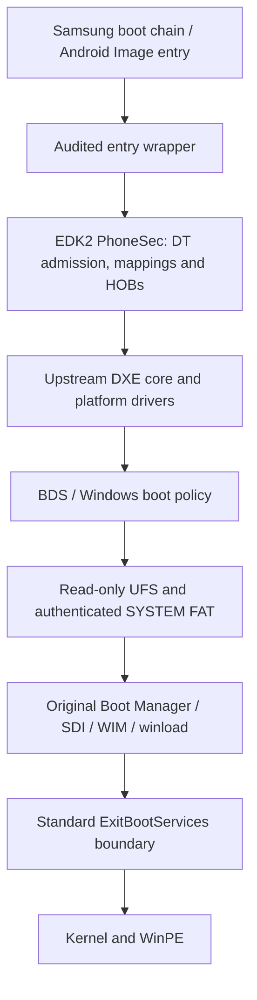

# Platform structure

The source snapshot retains the successful SEC68 runtime implementation.
Names/comments carrying older SEC numbers remain where changing them could
obscure source comparison. They are diagnostic identifiers, not a current
feature list. No historical SEC directories or full experiment logs are needed
to navigate this repository.

The last stage was physically observed with the original candidate. A new
public rebuild must establish its own execution evidence.

## Boundaries kept intact

- **Entry and images:** offline AArch64 PE mapping, bounded DIR64 relocation,
  retained ELF relocation audit, CRCs and exact FV/image binding. The wrapper
  stays within its existing 12MiB limit and the firmware volume within 9MiB.
- **Memory:** exact ownership, guards, section permissions and cache/CPU checks.
  The admitted high bank starts at `0x900000000` and spans 2GiB. Sampled
  bring-up was not a full-bank memory-cell test. Low private hardware DMA and
  trusted image/page-table ownership remain low.
- **Storage:** the real GPT SYSTEM identity/range is checked independently of
  historical Odin/PIT assumptions. The narrow UFS lease, private guarded DMA,
  CPU-buffer ownership, bounded task tags, ACK/completion, file-derived finite
  budgets and authenticated chunk copy are preserved. No media write path is
  enabled by the public build tools.
- **ACPI:** real N976N DT-derived GIC/timer/MPIDR information and BSP-only CPU
  publication. The Exynos 9810 reference's topology and addresses are not copied
  as N976N hardware proof.
- **Handoff:** standard upstream core/TimerDxe flow. Filesystem requests freeze
  and the inherited UFS DMA lists stop before OS ownership. Diagnostic callbacks
  are not a background timer after successful ExitBootServices.

`PcdImageProtectionPolicy=0` is intentional in this source: the local
BootstrapImagePolicyLib validates admitted images and applies exact section
permissions, while the hash-guarded RAM-stage overlay makes new code allocations
non-executable until publication. Replacing this combination with a different
coarse protection pass is a functional change, not extraction cleanup.

## Host input adapter

The firmware policy is unchanged. Host build paths and old receipt imports are
replaced by a small explicit contract. The contract pins boot inputs, the exact
FAT, chunk geometry/table, generated headers, full SDI/WIM identities and actual
SYSTEM identity. Both the preserved original seal and the new public format
must produce the same pinned artifact bytes. The new format asserts no physical
test result or previous qualification.

The exact reference FAT requirement is a current engineering constraint.
Supporting arbitrary media needs a separately validated implementation; deleting
the checks or accepting whatever manifest was supplied is not that implementation.

## Code entry points

Start with the package DSC/FDF, then `Sec/PhoneSec.c` and
`Library/PlatformBootManagerLib`. The entry assembler/C loader are in `entry/`.
The complete file map and source-extraction identities are in
[source-origin.json](../config/source-origin.json).
