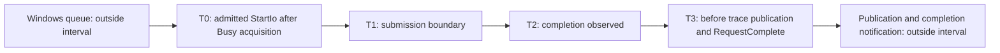

# Measuring the later UFS path

These notes explain the measurement design and lessons from later development.
The [SEC89 snapshot](../experimental/sec89-2026-11-16/README.md) contains selected
PROD1/TRACE1 source. **TRACE1 has not been physically applied or measured.**
Source/model observations and user-reported device results are distinguished.

## Measure declared boundaries

TRACE1 adds four software timestamps after a request has been admitted. They do
not measure every part of the Windows storage stack:

T1 to T2 includes controller progress **and** polling, sleep and scheduling.
It is not a pure device-latency measurement. T0 excludes earlier Windows queue
wait and Busy rejection; T3 excludes later trace publication, Busy release and
RequestComplete. Component times must not be subtracted from a different run's
application latency as though their boundaries were identical.

TRACE1 distinguishes attempt totals, per-kind detailed sampling (one in 65), a
128-entry ring and cumulative aggregates. A finite ring is not the full request
population. Invalid/failed/overwritten samples and instrumentation overhead need
to be accounted for before asserting averages, tails or p99. Even unsampled
requests have some instrumentation work; physical overhead is still unmeasured.

## More slots do not automatically improve throughput

A deferred multi-arena experiment showed a regression in user-reported results;
[the progress note](PROGRESS.md) gives the conditions and limits. Development
source/model analysis found substantially more guard work even for a single
outstanding request, while cumulative counters were consistent with count-one
processing. That identifies investigation targets, not a proven device-time
attribution or a controlled Android comparison.

Queue admission, worker handoff, completion observation, copy/guard traffic and
batch completion dependencies must be measured separately. Raising queue depth
alone does not demonstrate useful concurrency. The published operating baseline
remains PROD1's single-I/O path; the MQ experiment is on hold.

## Safety requirements and local diagnostic policy

Bounds, private DMA ownership, descriptor/PRDT preparation, response validation,
ACK/retirement, quarantine, finite waits and honest WRITE/FLUSH/FUA behavior are
separate from the choice of guard-scanning policy. Whole-arena scanning is a
project technique; it is not a universal requirement imposed by UEFI or UFS.

The later PROD1 policy combines a rotating 4KiB inactive-payload check with full
checks before use/initialization. Persistent inactive damage can take up to 16
subsequent post-check opportunities to be observed, with no idle-time deadline.
That coverage limit must be stated when comparing it to an earlier full scan.
Removing a redundant pass and reducing the bytes covered are different changes;
both require the affected lifetime and corruption-detection contract to be clear.

Keep host fake-DDI tests, emulation, final-code binding and physical observations
separate. They answer different questions. A source publication or an observed
faster desktop is not final hardware qualification.
